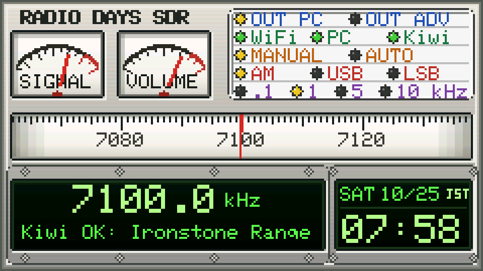

# RADIO DAYS SDR

**[English](README.md) | 日本語**

> **ダイヤルを回そう。どこかで、まだ誰かが起きている。**

なんでも便利になり、欲しいものがすぐ手に入る時代になりました。
だからこそ、少し不便なラジオを手に取ってほしい。

深夜、ダイヤルを回し、雑音の向こうにある遠い声を探す。
思いがけない放送と出会い、ディスクジョッキーのたわいないおしゃべりに救われ、もう少しだけ夜更かしする。
ベリカードが届くのを待った、あの時間を覚えている人にも、まだ知らない若い人にも。

**RADIO DAYS SDR** は、古い銀色のアナログチューナーを、ESP32 と KiwiSDR で現代によみがえらせる架空のレストモッドです。
博物館に飾るためではなく、もう一度、今の世界を聴くために。

世界各地の公開 [KiwiSDR](http://kiwisdr.com/) 受信機で短波放送を聴くシステムです。
**M5Stack Cardputer ADV**（＋ **U135 ロータリーエンコーダ**）をリモコン、**Mac または Windows 11 の PC** を本体として使います。
地球儀に表示する受信機を、ブラウザで選び・並べ替え・編集できる **Receiver Manager** を含みます。

> **状態: 個人の趣味のプロジェクトです。v1.10 GUIはCardputer ADV実機へ書き込み、2026年10月25日に見た目と主要操作を作者が確認・承認しました。OS共通表記にした最終版はPC上の全回帰テストに合格し、同日にLauncher（Wi-Fi）でCardputerへ導入して、ノブ選局、音量、MANUAL/AUTO、地球儀、OUT ADVでの30分再生を作者が確認しました（聴感での確認で、測定はしていません）。**
> **Windows 11 は 1 台の PC で試しました**（Windows 11、Python 3.12.10、Cardputer ADV 実機）。起動、Receiver Manager、Cardputer との接続、音量・ミュート・出力先の切替、終了は動作しました。他の Windows PC や長時間の使用は未検証です。
> 頼りにする前に、下の「確認できていること・いないこと」を読んでください。Linux は未対応・未検証です。



*画像はファームウェアの描画コードを PC で動かした画像で、実機の写真ではありません。*

## 役割分担

```
Cardputer ADV ──Wi-Fi: HTTP 8765 / UDP 8766 / 音声 TCP 8767──▶ Mac / Windows PC (radiodays_sdr.py) ──WebSocket──▶ KiwiSDR（インターネット）
 ノブ・キー・画面                                              デコード・音量・AUTO 選局・音の出力
                                                                Receiver Manager（ブラウザ, 127.0.0.1:8780）
```

| | Cardputer ADV | PC（Mac または Windows 11） |
|---|---|---|
| 役割 | リモコンと表示: 周波数・モード・音量・地球儀での受信機選択・状態灯。希望すれば内蔵スピーカーで音を出す（`O` キー） | 実際の処理: KiwiSDR への接続、音声のデコード、再生（または Cardputer への音声送信）、AUTO 選局、受信機一覧 `mac/servers.json` の管理、Receiver Manager 画面の提供 |
| ソフト | `firmware/RadioDays_SDR/RadioDays_SDR.ino`（コンパイル済みは `firmware/bin/`） | `mac/radiodays_sdr.py`（フォルダ名 `mac` は経緯によるもので、Mac と Windows の共通です）。下の OS 別の起動ファイルで起動 |

Cardputer画面右上の白いパネルは、出力先、**WiFi / PC / Kiwi**の通信状態、MANUAL/AUTO、AM/USB/LSB、選局刻み幅（0.1 / 1 / 5 / 10 kHz）を5段にまとめています。通信の3灯は緑=正常、黄=接続中、赤=異常。それ以外はアンバーが選択中です。

## 必要なもの

* **macOS** または **Windows 11**、**Python 3.9 以上**（Mac: `python3 --version` で確認、無ければ `brew install python`。Windows: <https://www.python.org/downloads/windows/> から導入し、**「Add python.exe to PATH」にチェック**）、初回起動時のインターネット接続。
  残り（`numpy`、`soundcard`（と `cffi`）、KiwiClient ライブラリ）は、起動ファイルが `mac/.venv` に自動で導入します。他に必要なものはありません。
* M5Stack **Cardputer ADV**（＋ U135）。Cardputer とパソコンは**同じ LAN**に接続（ゲスト Wi-Fi など端末間通信を禁止するネットワークは不可）。
* ファームウェアを自分でビルドする場合: `arduino-cli`、コア `m5stack:esp32` 3.3.10、ライブラリ M5Cardputer / M5Unified / M5GFX / ArduinoJson 7（[THIRD_PARTY_NOTICES.md](THIRD_PARTY_NOTICES.md) 参照）。

## どのファイルをダブルクリックするか

このリポジトリをダウンロード（または `git clone`）し、フォルダ全体をそのまま置いてください。一番上のフォルダに、**OS 名の付いた起動ファイルが 4 つだけ**あります。

| | macOS | Windows 11 |
|---|---|---|
| **ラジオを聴く**（ラジオを起動し、Receiver Manager をブラウザで開く） | `Start RADIO DAYS Mac.command` | `Start RADIO DAYS Win.bat` |
| 受信機の一覧だけ編集する（ラジオは起動**しない**） | `Open Receiver Manager Mac.command` | `Open Receiver Manager Win.bat` |

通常は、**自分の OS の上の段のファイルだけ**をダブルクリックします。下の段はラジオなしで一覧を編集したいときだけで、両方を起動する必要はありません。
それ以外（`mac/` のプログラム、Receiver Manager の画面、`servers.json`、確認履歴、操作ガイド）は、**どちらの OS でも同じもの**です。

### macOS
1. **`Start RADIO DAYS Mac.command`** をダブルクリック（または Terminal で実行）。
   * 初回だけ: `mac/.venv` を作り、`mac/requirements.txt` のパッケージを導入し、KiwiClient ライブラリを取得します
     （固定した 1 つのコミットを取得して SHA-256 を検証。同梱しない理由は [THIRD_PARTY_NOTICES.md](THIRD_PARTY_NOTICES.md)）。
   * 「開発元を検証できません」と出たら、右クリック → 開く。または `xattr -dr com.apple.quarantine <このフォルダ>`。
   * Python への「ローカルネットワーク」やファイアウォールの許可ダイアログは**許可**してください（Cardputer との通信に必要）。
2. Terminal に `Mac IP …` が出て、**ブラウザで Receiver Manager が自動的に開きます**（起動のたびに毎回。下記）。ブラウザを閉じてもラジオは止まりません。止めるときは Terminal のウィンドウで Ctrl+C。

音は Mac の既定の出力から出ます。変えるには `"./Start RADIO DAYS Mac.command" --sound-device "デバイス名の一部"`（一覧: `--list-devices`）。

### Windows 11（1 台の PC で確認）
1. python.org から **Python 3.12 または 3.13** を導入（*Add python.exe to PATH* にチェック）。3.9 以上が必要です。
2. **`Start RADIO DAYS Win.bat`** をダブルクリック。黒いウィンドウが開きます。
   * 初回だけ: `mac\.venv` を作り、パッケージの導入と KiwiClient ライブラリの取得を行います（インターネット接続が必要、数分）。
   * Windows SmartScreen が「PC が保護されました」と出たら、*詳細情報 → 実行*（ファイルは普通のテキストなので、先に中身を読めます）。
   * Windows のファイアウォールが Python について聞いてきたら、**プライベート ネットワーク**を許可してください（Cardputer との通信に必要）。
3. ウィンドウに PC の IP アドレスが出て、**ブラウザで Receiver Manager が自動的に開きます**。ブラウザを閉じてもラジオは止まりません。止めるときは、黒いウィンドウで Ctrl+C か、ウィンドウを閉じます。
4. 起動ファイル自身のメッセージは、バッチファイルと日本語の相性の問題を避けるため、英語だけです。プログラムのメッセージは日本語と英語です。

音は Windows の既定の再生デバイスから出ます（Cardputer スピーカー出力のときは PC のスピーカーは使いません）。変えるには `"Start RADIO DAYS Win.bat" --sound-device "デバイス名の一部"`（一覧: `--list-devices`）。
ラジオの動作中、Windows はスリープしないようにします。

## Cardputer ADV に書き込む

**Cardputer ADV 単体ではSDR放送を受信できません。** 受信には、Macまたは
Windows PC上で動作するRADIO DAYS SDRプログラム（Receiver Managerを含む）、
そのPCからKiwiSDR受信機へ接続するためのインターネット接続、および
CardputerとPC間のネットワーク接続が必要です。

### M5Burnerでインストールする

1. M5Burnerを開き、**`RADIO DAYS SDR`** を検索します。
2. **RADIO DAYS SDR** を選択し、M5Burnerのインストール操作で
   Cardputer ADVに書き込みます。

RADIO DAYS SDRをインストールすると、Cardputer ADVに入っているLauncherや
ほかのファームウェアが上書きされる場合があります。残しておきたいものを
復元できるようにしてからインストールしてください。

### 手動でインストールする

コンパイル済みイメージは `firmware/bin/`（チェックサムは `SHA256SUMS.txt`）。ボード設定: M5Cardputer / Flash 8MB / Partition `default_8MB`。

```bash
pip install esptool
esptool --chip esp32s3 --port /dev/cu.usbmodemXXXX write-flash 0x0 firmware/bin/RadioDays_SDR.ino.merged.bin
```

書き込めないときは、側面ボタン（G0）を押したまま電源を入れる（ダウンロードモード）。**本体の既存ファームウェア（例: ネットラジオ版 RADIO DAYS）は消えます。**
ソースからビルドする場合は `firmware/build.sh`。このリポジトリの `.ino` と `.bin` は同じソースから作った一組です（版番号 `SDR-1.10`）。

初回起動: Wi-Fi 一覧から選び（`;` `.` またはノブ、ENTER）、パスワードを入力して ENTER。PC は自動検出されます。検出されないときは `I` キーで、起動ファイルのウィンドウに出た IP アドレスを入力します。
**Cardputer の表示について:** v1.10の通常画面は、左上が背の低い横長のSIGNAL/VOLUMEアナログメーター、右上が上端にそろえた5段の状態表示、その下が上へ詰めた横長のチューニング目盛りです。右上の5段は等高で、1pxの薄い灰色罫線により分け、M5Stackの裏面印刷を意識して青・緑・橙・赤・紫の文字で機能別に色分けしています。通信LEDの緑・黄・赤という状態の意味は維持します。計器の黒い縁は原則1pxで、盤面の上・左内側の灰色影により凹みを表現しています。最下部は、周波数・受信状態用とG-SHOCK風の時計用を別々の窪みにした、黒地・蛍光緑の2個の液晶です。上下の銀色レールは等高で、左は上下4本ずつ、時計は上下2本ずつのマイナスねじを液晶外側に見せています。受信周波数と時計の時刻は、どちらも大きく太いビットマップ数字です。単位`kHz`と状態行は小さな通常文字のままです。古い受信機へ現代の時計モジュールを後付けした外観を意図しています。モード変更時はAM=5 kHz、USB/LSB=1 kHzの推奨刻み幅になります。地球儀画面の人工衛星は初代RADIO DAYSと同じように漂い、地球と電波をやり取りします。Cardputerの接続案内はOS共通の`PC`表記です。
5段パネルは各段を同じ高さにそろえ、区切り線は薄い灰色です。下段の2個の液晶は、表示面の上下に同じ高さの銀色レールを設けています。
Receiver Manager と操作ガイドの画面は**英語が初期表示**です。上部の **日本語 / EN** ボタンで切り替えられ、選んだ言語はそのブラウザに記憶されます。

操作の早見表は **操作ガイド**（[日本語](docs/QUICK_GUIDE_JA.md) / [English](docs/QUICK_GUIDE_EN.md)。Receiver Manager 画面の上部のボタンからも開けます）、詳細は [docs/OPERATION_JA.md](docs/OPERATION_JA.md)。要点: ノブ = 選局、ノブを押しながら回す = 音量、`G` = 地球儀、`Tab`/`T` = MANUAL⇄AUTO、`O` = 音の出力先、`D` = 診断、`H` = ヘルプ。

## Receiver Manager（受信機の選択・並べ替え）

**「Start RADIO DAYS」の起動ファイル（Mac: `Start RADIO DAYS Mac.command`、Windows: `Start RADIO DAYS Win.bat`）は、起動のたびに、既定のブラウザで Receiver Manager を自動的に開きます**（アドレスは **<http://127.0.0.1:8780/>**。ラジオの動作中に自分で入力して開くこともできます）。ブラウザのタブを閉じてもラジオは止まりません。ブラウザを開けなかったときは、Terminal にアドレスを表示し、ラジオはそのまま動きます。
通常のラジオ利用では **「Start RADIO DAYS」のファイルだけ**を起動します。「Open Receiver Manager」のファイル（`... Mac.command` / `... Win.bat`）は、**ラジオを起動せずに**一覧だけ編集したいとき用です（こちらも毎回ブラウザを開きます）。すでに Receiver Manager が動いているときは、2 つ目を起動せず、既存の画面を開きます。
ポート 8780 を別のプログラムが使っているときは、ウィンドウにその旨と調べ方（Mac は `lsof`、Windows は `netstat`。または `--manager-port` / `--port` で別の番号を指定）を表示します。ポートが使用中というだけでは RADIO DAYS のものとは見なさず、そのポートのプログラムが自分は RADIO DAYS の Receiver Manager だと名乗ったときだけ、既存の画面として扱います。
画面は PC 側のプログラムが**この PC の中だけ**（`127.0.0.1`）に提供し、そのプログラム経由で `mac/servers.json` を読み書きします。

* **登録済みの受信機**（左）: `≡` のドラッグまたは ↑↓ で並べ替え、`×` で登録解除、名前・短い名前・ホスト・ポート・緯度・経度をその場で編集、パスワードは「詳細」。この順番が Cardputer の地球儀の一覧の順番です（最大 32 台）。
* **候補**（右）: 公開 KiwiSDR 一覧から作った約 120 台（日本 25 台）。チェックで登録、外すと登録解除。検索、「日本のみ」、国・登録状態のフィルタ。
* **手動で追加**: ホスト名とポート（自分の KiwiSDR など）。
* **保存して反映**: `mac/servers.json` に保存し、動作中のプログラムにも即座に読み込ませます。Cardputer では `G` を押し直すと新しい一覧になります。使用中の受信機を外した場合は、先頭の受信機に切り替わります。
* **確認ボタン**（結果には「何をしたか」をそのまま表示します）:
  * *HTTP確認*: `http://ホスト:ポート/status` に 1 回問い合わせるだけです。受信機の Web サーバーが答えたことしか分かりません。**音声が受信できるかは分かりません。**
  * *音声確認(約7秒)*: 実際に接続し、音声ブロックが届くかを調べます。相手の受信機の枠を一時的に 1 つ使うので、必要なときだけ押してください。
  * **確認履歴**: 受信機ごとに、前回の HTTP確認と前回の音声確認を**別々に、日時つきで** `mac/check_history.json`（`servers.json` の隣。`servers.json` の中には入れないので一覧の形式は変わりません。git には含まれません）に保存します。ブラウザを閉じて開き直しても、プログラムを再起動しても表示され、未確認のものは「未確認」と出ます。日時は日本語表示では「10月24日 14:12（3時間前）」の形、英語表示では「Oct 24, 2:12 PM (3 h ago)」の形です。結果は**その時点のもの**で、「応答あり」は今接続できることの保証ではありません。画面を開いただけでは受信機に問い合わせません。
  * **HTTP の一括再確認**（「登録済みをHTTP再確認」「表示中の候補をHTTP一括確認」を押したときだけ）: 台数を示して確認を求め、同時に最大 4 件・少し間隔をあけて順番に問い合わせ、途中で中止できます。プログラム側でも、同時に実行する HTTP確認は 4 件を超えません。音声確認の一括実行はありません。
  * 候補は**「接続できる」と断定して表示しません**。一覧は公開一覧のある時点のスナップショットです（日付は画面と `mac/manager/receiver_candidates.json` に記録）。プロキシ経由の受信機（`*.proxy.kiwisdr.com`）はポート 8073 を仮定しており、「ポート仮定」と表示します。
  * 候補の位置は各受信機の自己申告です。確認のうえ使ってください。位置のない受信機は「位置未確認」と表示され、地球儀に点は出ません。
* **操作ガイド**: 画面上部のボタンで、操作早見表（基本操作・受信機の選択・MANUAL/AUTO・音声出力・Receiver Manager・右上の5段状態表示・接続トラブル）を別タブで開きます（日本語/英語）。文面は `mac/manager/guide.json` の 1 か所だけで、`docs/QUICK_GUIDE_*.md` はそこから生成します。
* **保存の安全性**: 先に入力を検証します（ホスト、ポート 1〜65535、名前は ASCII で 43 / 20 文字以内、緯度経度、重複なし、1〜32 台）。新しい内容は一時ファイルに書いて確実にディスクへ書き出し、読み戻して一致を確認してから、一度の置き換えで反映します。直前の正常なファイルは `mac/servers.json.bak` と `mac/.servers_backups/`（最新 10 個）に残ります。壊れた `servers.json` は `servers.json.corrupt-<時刻>` として保存し、プログラムは直前の正常なコピーで起動します。**「直前の保存に戻す」**で元に戻せます。画面を開いた後に別の場所でファイルが変わっていたときは、上書き前に確認します。
* **セキュリティ**: 画面は `127.0.0.1` だけで待ち受けます。リクエストには正しい `Host`・外部ではない `Origin`・専用ヘッダ・JSON が必要です。パスワードはブラウザに送らず、「設定済み」とだけ伝えます。`servers.json` はモード 600 で保存します。

`mac/servers.json` は初回起動時に `mac/servers.default.json` から作られ、git の管理対象外です。形式（プログラム停止中なら手で編集もできます）:

```json
{"name": "Osaka, Japan (表示用の名前)", "short": "Osaka JP", "host": "example.ddns.net", "port": 8073,
 "lat": 34.8585, "lon": 135.5144, "pos_source": "位置の根拠（任意のメモ）", "password": ""}
```

## ネットワークについて

* PC 側プログラムの API（TCP 8765）・探索（UDP 8766）・Cardputer スピーカー用音声（TCP 8767）は、Mac の**すべてのネットワークインターフェース**で待ち受け、共有トークン（既定 `RADIO_DAYS_LOCAL_2026`。ファームウェアに埋め込み、`--token` で指定）だけで守られています。信頼できる家庭内 LAN 向けです。トークンは**秘密ではなく**、信頼できないネットワークには向きません。変えるには `.ino` の `TOKEN` を変えてビルド・書き込みし、Mac 側を `--token` 付きで起動します。
* Receiver Manager（TCP 8780）は自分の PC だけ（loopback）です。`--manager-port 0` で無効にできます。
* 同じ IP アドレスからの 2 つ目の接続を断る KiwiSDR が多くあります。同じ受信機に 2 つのプログラムから同時に繋がないでください。

## 確認できていること・いないこと

凡例: **テスト済み** = ここで実行して合格 ／ **実機** = 実際の KiwiSDR や実機が関わる ／ **未検証** = 実行していない。

| 項目 | 状態 |
|---|---|
| Mac プログラム: API、音量・ミュートの実出力レベル測定（BlackHole）、出力切替、AUTO 選局の論理（模擬の電波）、音声ストリームの規約 | **テスト済み**（自動テスト 37 件） |
| 実際の KiwiSDR からの受信、実際の受信機での AUTO 選局 | **テスト済み・実機の KiwiSDR**（2026-10-23/24。受信できるかは時間帯と受信機による） |
| Receiver Manager: 保存と検証、原子的な保存・バックアップ・復元、壊れたファイルへの退避、HTTP のセキュリティ（Host/Origin/CSRF/サイズ）、競合検出、確認結果の文言、候補ファイルの形式 | **テスト済み**（自動テスト 26 件: 保存・セキュリティ 14 件 + 確認履歴・一括確認の上限・記録 12 件） |
| Receiver Manager 画面のロジック（並べ替え、検証、送信内容、フィルタ、結果の文言） | **テスト済み**（Node テスト 15 件。日時の日本語/英語表記と一括実行の同時数の上限も含む） |
| 動作中のプログラムに対するブラウザ画面の通し試験: 候補の選択、並べ替え、保存、動作中プログラムの `/servers` に新しい一覧が出ること、バックアップとファイルの書き出し | **テスト済み**（ブラウザでの手動操作、2026-10-24） |
| 公開一覧の日本の候補への確認（2026-10-24、2 回）: HTTP 確認は 2 回とも 25 台中 23 台が応答（同じ 23 台とは限りません）。1 台（Adachi）で音声確認を実行し音声ブロックが届いた | **実機の KiwiSDR・ある時点の分**。他の時間については何も言えません |
| 確認履歴がページの再読み込み後も表示される／HTTP と音声が別々に記録される／日本の候補 25 台の一括 HTTP 確認が同時 4 件以内で動く／画面を開いただけでは確認リクエストが出ない／操作ガイドが別タブで日本語・英語で開く | **テスト済み**（ブラウザ、2026-10-24） |
| 操作ガイドと実装の一致: ファームウェアが処理するすべてのキーがガイドにある、キーが `docs/OPERATION_JA.md` にある、数値と右上の表示内容が一致 | **テスト済み**（自動テスト） |
| ファームウェアのコンパイル。同じソースから `.ino` と `.bin` を作成。ブートローダーとパーティション表は前の版と同一 | **テスト済み**（arduino-cli のビルド成功） |
| ファームウェアの描画ロジックと画面遷移を、実際のソースから PC 上で描画して検証（85 項目）、音声プロトコルと再生規則（host_tests） | **テスト済み**（PC 上のシミュレーション。実機ではありません） |
| **Cardputer ADV 実機でのすべて**: 書き込み・起動・画面の見え方・5段状態表示・JST時計・キーとノブ・Wi-Fi・地球儀・**Receiver Managerで保存した一覧が地球儀に出ること**・AUTO選局・Cardputerスピーカー | **未検証**（作者が実機で確認します） |
| **Windows 11**: PC 側プログラム全体を Windows で動かすこと（起動ファイル、Python の導入、音声出力、ファイアウォール、ブラウザの自動起動、Receiver Manager、Cardputer との通信） | **作者が 1 台の Windows 11 PC で確認**（Python 3.12.10、Cardputer ADV 実機）: 起動、ブラウザ、Receiver Manager、Cardputer との接続、音量・ミュート・出力先の切替、終了、2 回目の起動。**未検証:** 他の Windows PC、長時間の使用、Python 3.9 / 3.10、以前 1 回だけ起きた「Cardputer と無関係に PC から鳴る」現象の原因（再現せず） |
| Linux | **未対応・未検証** |
| 長時間動作、スリープ復帰、他の Wi-Fi 環境、他の Mac / macOS | **未検証** |

詳細: [docs/VERIFICATION_JA.md](docs/VERIFICATION_JA.md)（全記録）と [docs/VERIFICATION.md](docs/VERIFICATION.md)（英語の要約）。

## テストの実行

```bash
cd mac
.venv/bin/python -m unittest discover -s tests -p "test_*.py"     # 105 件。音量テストは BlackHole 2ch があるときだけ実行（無ければスキップ）
node tests/js/test_logic.js                                       # Receiver Manager 画面のロジック
cd ../firmware/tools/host_render && M5GFX=/path/to/libraries/M5GFX ./run.sh   # 画面描画テスト（PC 上。g++ が必要）
cd ../host_tests && PYTHON=../../../mac/.venv/bin/python ./run.sh             # 音声プロトコル・再生規則のテスト（PC 上）
```

## フォルダ構成

```
Start RADIO DAYS Mac.command   macOS: ラジオを起動し、Receiver Manager をブラウザで自動的に開く
Start RADIO DAYS Win.bat       Windows 11: 同じ
Open Receiver Manager Mac.command / ... Win.bat   ラジオなしで Receiver Manager だけ起動（動作中なら既存の画面を開く）
mac/                           PC 側プログラム。macOS と Windows 共通（フォルダ名は経緯によるもの）
mac/radiodays_sdr.py           プログラム本体（ラジオ、Cardputer との通信）
mac/platform_support.py        OS ごとに違う少数の部分（LAN アドレス、ポート共有、コンソール、スリープ）
mac/servers_store.py           servers.json の検証つき・破損しにくい読み書き
mac/receiver_manager.py        Receiver Manager のバックエンド（loopback の HTTP）
mac/check_history.py           受信機ごとの確認履歴（check_history.json）
mac/manager/                   Receiver Manager 画面（index.html, app.js, style.css, receiver_candidates.json）
                               と操作ガイド（guide.html, guide.js, guide.json = ガイド文面の唯一の原本）
mac/servers.default.json       初期の一覧
mac/tools/                     fetch_kiwiclient.py, build_candidates.py, kiwi_position.py, build_guide_docs.py
mac/tests/                     自動テスト（live_*.py は実際の受信機を使います）
firmware/RadioDays_SDR/        Cardputer ADV 用ソース（.ino とヘッダ）
firmware/bin/                  コンパイル済みイメージ + SHA256SUMS.txt     firmware/build.sh  再ビルド
firmware/tools/                描画・音声の PC 上テスト
docs/                          操作ガイド（QUICK_GUIDE_JA/EN は生成物、OPERATION_JA は詳細）、検証記録、プレビュー画像
```

## ライセンス

MIT（[LICENSE](LICENSE)）。第三者のコンポーネントとデータ: [THIRD_PARTY_NOTICES.md](THIRD_PARTY_NOTICES.md)。
KiwiSDR・M5Stack とは無関係の個人プロジェクトです。公開 KiwiSDR 受信機はそれぞれの運営者のものです。制限とルールを守ってください。
